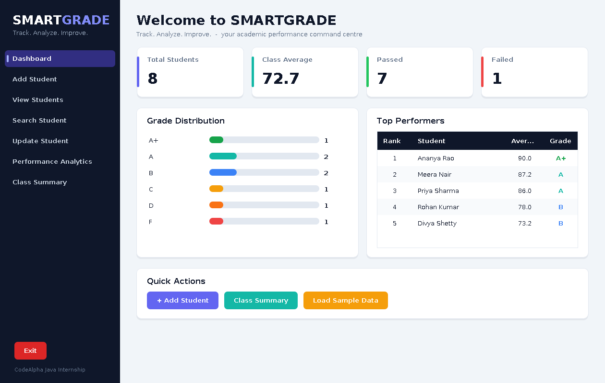
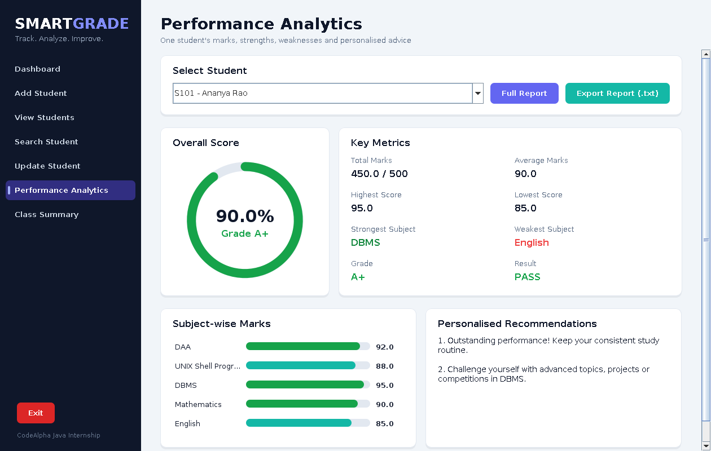
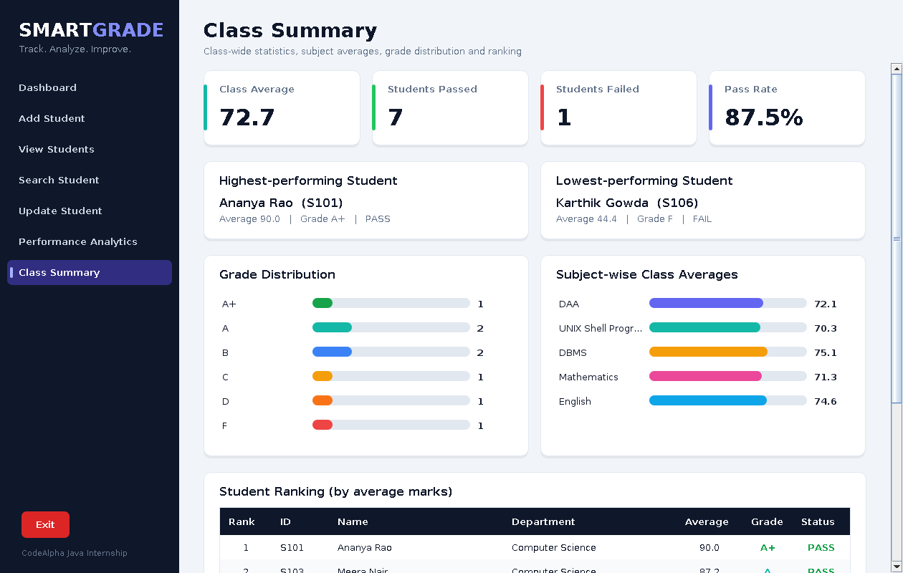

# SMARTGRADE - Student Academic Performance & Analytics System

> **Track. Analyze. Improve.**

A complete Java Swing desktop application that helps teachers and students manage academic records,
calculate performance, analyse subject-wise marks, find strengths and weaknesses, and generate reports.
Built for the **CodeAlpha Java Programming Internship** (Task: *Student Grade Tracker*).

## Features

**Core CodeAlpha requirements**
- Add student details, view all students, search by unique ID (or name)
- Store marks for multiple subjects (ArrayList)
- Total, average and percentage calculation
- Highest and lowest score, grade (A+, A, B, C, D, F), PASS / FAIL status
- Student performance summary report

**Extra features**
- Update student details and subject marks separately, delete students
- Strongest / weakest subject and rule-based personalised recommendations
- Class analytics: class average, topper, lowest performer, subject-wise averages, pass/fail count, grade distribution, ranking
- Modern dashboard with stat cards, bar charts and a circular score gauge
- Export student report / class report to `.txt` (saved in `reports/`)
- Automatic saving to CSV - records survive restarts
- "Load Sample Data" button for demos

## Technologies
Java 21 (JDK 21) · Java Swing · OOP · ArrayList · Java File I/O (CSV) · try-catch + custom `ValidationException` · IntelliJ IDEA

## Project structure
```
SMARTGRADE/
├── src/
│   ├── Main.java               Application entry point
│   ├── Student.java            Student model (encapsulated fields)
│   ├── StudentManager.java     Add / update / delete / search (ArrayList)
│   ├── GradeCalculator.java    Total, average, %, grade, pass/fail, recommendations
│   ├── PerformanceAnalyzer.java Class analytics + text reports
│   ├── FileManager.java        Save / load CSV
│   ├── Validation.java         All input validation
│   ├── ValidationException.java Custom exception
│   └── Dashboard.java          Swing GUI (sidebar + 7 pages)
├── test/TestRunner.java        42 console tests
├── data/                       students.csv is created automatically
├── reports/                    exported reports
└── docs/                       screenshots + test-results.txt
```

## Installation and execution

**IntelliJ IDEA**
1. `File > Open` and select the `SMARTGRADE` folder (or `File > New > Project from Existing Sources`).
2. `File > Project Structure > Project`: set SDK to **JDK 21**.
3. Right-click the `src` folder > *Mark Directory as > Sources Root*.
4. Open `Main.java` and click the green **Run** arrow.

**Command line**
```bash
javac -d out src/*.java
java -cp out Main
```
Run from the project root so that `data/students.csv` is created inside the project.

## Grading scale
| Percentage | Grade | Result |
|---|---|---|
| 90 and above | A+ | PASS |
| 80 - 89 | A | PASS |
| 70 - 79 | B | PASS |
| 60 - 69 | C | PASS |
| 50 - 59 | D | PASS |
| below 50 | F | FAIL |

## Screenshots
Located in `docs/screenshots/`: `01-dashboard.png`, `02-add-student.png`, `03-view-students.png`,
`04-search-student.png`, `05-update-student.png`, `06-performance-analytics.png`, `07-class-summary.png`.





## Test cases and results
Run `test/TestRunner.java`. Result: **42 passed, 0 failed** (full log in `docs/test-results.txt`).

| # | Test case | Expected | Result |
|---|---|---|---|
| 1 | Multiple student records (8) | All stored | PASS |
| 2 | Duplicate student ID | Rejected with message | PASS |
| 3 | Empty name | Rejected | PASS |
| 4 | Invalid ID (symbols / spaces / empty) | Rejected | PASS |
| 5 | Name with spaces ("Ananya Rao") | Accepted | PASS |
| 6 | Marks below zero (-5) | Rejected | PASS |
| 7 | Marks above 100 (101) | Rejected | PASS |
| 8 | Letters instead of marks ("abc") | Rejected, no crash | PASS |
| 9 | Search by ID / partial name / unknown | Correct results | PASS |
| 10 | Update details and marks | Values change | PASS |
| 11 | Delete student | Removed from list and file | PASS |
| 12 | Save and load (restart simulation) | Same data returned | PASS |
| 13 | Grade boundaries 90/80/70/60/50/49.9 | A+/A/B/C/D/F | PASS |
| 14 | Class analytics (topper, lowest, pass/fail, distribution, ranking) | Correct | PASS |

## GitHub setup
```bash
cd SMARTGRADE
git init
git add .
git commit -m "SMARTGRADE - Student Academic Performance & Analytics System"
git branch -M main
git remote add origin https://github.com/<your-username>/SMARTGRADE.git
git push -u origin main
```
Create the empty repository `SMARTGRADE` on github.com first (no README/.gitignore). Add your own screenshots to `docs/screenshots/`.

## Short demo explanation (for the internship video / viewers)
"SMARTGRADE is a Student Grade Tracker built in Java 21 with Swing. Teachers can add students with marks for
several subjects, and the app instantly calculates total, average, percentage, grade and pass/fail. The
Performance Analytics page shows one student's strongest and weakest subjects with personalised advice, and the
Class Summary page shows the class average, topper, grade distribution and ranking. All input is validated -
duplicate IDs, empty names and invalid marks give clear messages instead of crashing - and every change is saved
to a CSV file, so data survives restarts. The code is split into small OOP classes: Student, StudentManager,
GradeCalculator, PerformanceAnalyzer, FileManager, Validation and Dashboard."
